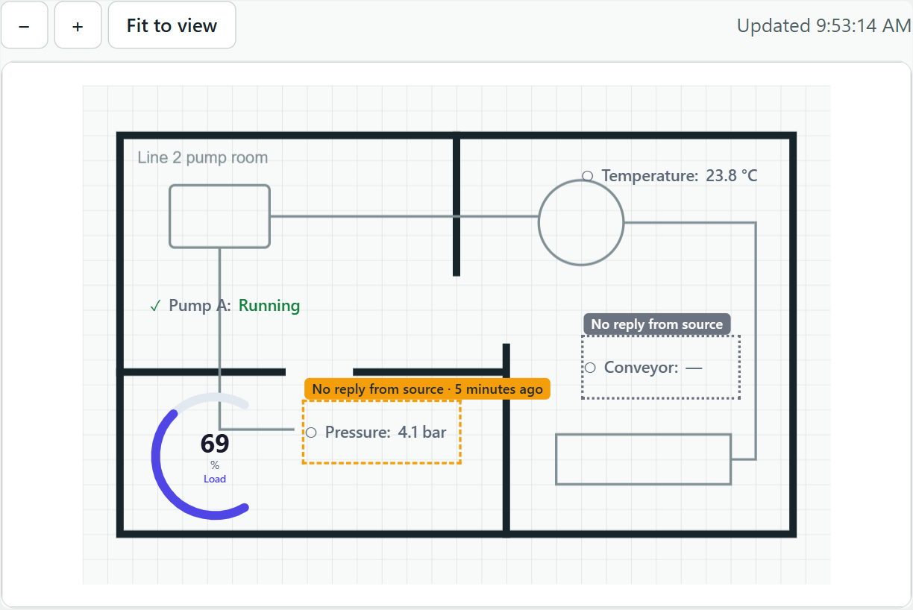

# U-Board

A board language and a React viewer for spatial dashboards. Describe a board as JSON — values bound to your systems,
parts placed on a floor plan, a diagram, a map or a grid — and draw it live in any web application.



## Features

- **One JSON document per board.** Where its values come from, what it shows and where — checked by a validator with a
  published JSON Schema.
- **Canvas and grid layouts.** Place parts on a background image, or lay them out in order on a responsive grid; a grid
  cell can hold a canvas.
- **Live data, read-only.** A board binds to values through adapters you write; U-Board never owns or stores your data.
- **Honest about freshness.** Every value carries its connection quality — live, stale or disconnected — and why, shown on
  the part itself.
- **Your own elements.** Define markup and CSS (or a sandboxed script) once and place it like any built-in part.
- **Light to embed.** The viewer is a separate entry point with no editor in it.

## Install

```sh
npm install @iyulab/u-board react react-dom
```

React 19.2 or later is a peer dependency. The package is ESM-only and needs Node 22.12 or later.

## Use it

Validate a board and draw it:

```tsx
import { validateBoard, type Adapter, type Board } from '@iyulab/u-board/domain';
import { BoardView } from '@iyulab/u-board/viewer';
import '@iyulab/u-board/styles.css';

const board: Board = { parts: {}, layout: { kind: 'canvas', size: [1280, 720], place: {} } };
const adapters: Adapter[] = [/* your adapters */];

validateBoard(board); // [] — nothing to refuse

<div style={{ height: 600 }}>
  <BoardView board={board} adapters={adapters} />
</div>;
```

An adapter resolves a reference in your system to a value and its quality. The
[API reference](docs/api-reference.md) has a complete, runnable example that implements one.

| Entry point | For |
|---|---|
| `@iyulab/u-board/domain` | The board language: types, JSON Schema, validation, the adapter contract. No React. |
| `@iyulab/u-board/picture` | The model a renderer, a server or an assistant reads off a board. No React. |
| `@iyulab/u-board/viewer` | `BoardView`, the React viewer. |
| `@iyulab/u-board/toolkit` | The renderer's building blocks, for tools that edit boards. |

To edit boards, use [`@iyulab/u-board-designer`](https://www.npmjs.com/package/@iyulab/u-board-designer), which builds
on this package. The authoring tool, the MCP server and the application server live in
[u-board-studio](https://github.com/iyulab/u-board-studio).

## What it is not

U-Board is not a business-intelligence tool, an HMI/SCADA package or a 3D digital-twin engine, and it does not own the
data it shows. See [docs/scope.md](docs/scope.md).

## Documentation

- [Overview](docs/overview.md) · [Concepts](docs/concepts.md) · [Architecture](docs/architecture.md)
- [API reference](docs/api-reference.md)
- [Principles](docs/principles.md) · [Scope](docs/scope.md)

## Contributing

Bug reports and design questions are welcome; see [CONTRIBUTING.md](CONTRIBUTING.md).

## License

MIT. See [LICENSE](LICENSE).
